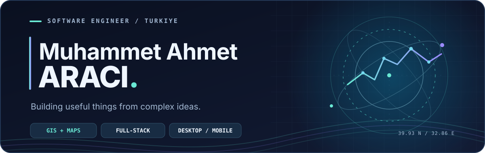

<div align="center">

<picture>
  <source media="(prefers-color-scheme: dark)" srcset="https://raw.githubusercontent.com/ahmetaraci/ahmetaraci/main/assets/profile-banner-dark.svg">
  <source media="(prefers-color-scheme: light)" srcset="https://raw.githubusercontent.com/ahmetaraci/ahmetaraci/main/assets/profile-banner-light.svg">
  
</picture>

<br>

<a href="https://www.linkedin.com/in/ahmet.araci/"></a>
<a href="https://ahmetaraci.github.io/"></a>
<a href="mailto:muhammetahmet.araci@gmail.com"></a>

</div>

## Hey, I'm Ahmet 👋

I'm a software developer based in **Türkiye**, with a soft spot for **geospatial systems** and a curiosity that goes well beyond maps.

I like taking complicated ideas and turning them into **useful, approachable software** — from GIS-backed platforms and full-stack applications to native-feeling desktop tools and mobile experiences.

- 🗺️ **Geospatial engineering:** spatial data, interactive maps and location-aware systems
- 🧩 **Full-stack development:** thoughtful interfaces, APIs, databases and the things connecting them
- 🛠️ **Building across platforms:** web, desktop, mobile and developer tooling
- ✨ **What matters to me:** practical solutions, clean architecture and the little UX details

## Things I build with

| Area | Technologies |
| :--- | :--- |
| **Frontend & mobile** | TypeScript · JavaScript · React · React Native · Expo |
| **Backend & data** | Node.js · NestJS · PHP · Python · PostgreSQL |
| **Geospatial** | PostGIS · OpenLayers · Leaflet · GeoJSON |
| **Desktop & tools** | Tauri · Rust · Kotlin · Docker · Git |

## Selected open-source work

| Project | What it does |
| :--- | :--- |
| 🗺️ **[JSON Server + GeoJSON Guide](https://github.com/ahmetaraci/json-server-geojson-rehber)** | A Turkish walkthrough for serving GeoJSON and displaying it with Leaflet or OpenLayers. |
| 🎨 **[Favicon Generator](https://github.com/ahmetaraci/favicon-generator)** | A handy web utility for generating favicon assets from an image. |
| 🧭 **[Türkiye DOM](https://github.com/ahmetaraci/trillerdom)** | A Leaflet-based map exploring central meridians for Türkiye's provinces. |
| 📷 **[CR2 to JPEG](https://github.com/ahmetaraci/cr2tojpeg)** | A desktop utility for batch-converting Canon RAW photos into JPEGs. |

## Currently exploring

```text
  desktop experiences     → Tauri + Rust
  mobile-first ideas      → React Native + Expo
  better developer tools  → automation + thoughtful workflows
  everything geospatial   → maps + data + real-world problems
```

I enjoy working across the stack, learning by building and making technology feel a little more human.

<div align="center">

---

**Have an interesting idea or a problem worth solving?**

[Let's connect on LinkedIn](https://www.linkedin.com/in/ahmet.araci/) · [Read my writing](https://ahmetaraci.github.io/) · [Send me an email](mailto:muhammetahmet.araci@gmail.com)

<sub>Made with curiosity, coffee and a lot of commits. ☕</sub>

</div>
